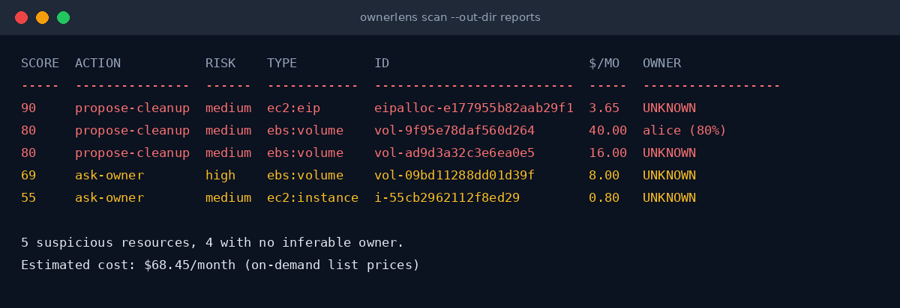

# cloud-ownerlens

[](https://github.com/nikhilrai-tech/cloud-ownerlens/actions/workflows/ci.yml)
[](LICENSE)
[](pyproject.toml)
[](#it-cannot-change-your-infrastructure)

**Find unused cloud resources nobody owns, work out who they belong to, and ask before anyone touches them.**



*Demo on a fake account. The production-tagged volume is capped at `ask-owner`: it never gets a cleanup proposal.*

## Why

Every cloud account collects stopped VMs, unattached disks, idle NAT gateways and snapshots of volumes that no longer exist.
Cost tools tell you they are expensive. They don't tell you **who owns them**, what that person **answered**, or whether
a **backup exists**. And owners rarely say "delete it": they say "we might need it later". ownerlens handles that part.

## Try it

```bash
git clone https://github.com/nikhilrai-tech/cloud-ownerlens && cd cloud-ownerlens
python3 -m venv .venv && .venv/bin/pip install -e .
.venv/bin/ownerlens scan --regions us-east-1 --explain      # uses your normal AWS credentials, read-only
```

Needs only read permissions (policy below). GCP and Azure are experimental.

## What it answers

For each suspicious resource:

1. **Is it unused?** (zombie score from CloudWatch + resource state)
2. **Who owns it?** (tags, people named in Name tags, CloudTrail creator, combined into a confidence score)
3. **What should happen?** `keep`, `ask-owner`, or `propose-cleanup`

## It cannot change your infrastructure

- Every AWS call goes through [`guard.py`](src/ownerlens/guard.py), which only allows `Describe*`, `Get*`, `List*`
  and `Lookup*` operations. Anything else raises `ReadOnlyViolation` **before** it is sent.
- There is no delete/stop/tag code in the repo, and a test fails if one is ever added.
- `propose-cleanup` is only a label in a report. Resources tagged production, or managed by a
  Kubernetes cluster, are capped at `ask-owner`.
- Reports are files on disk. Owner messages are drafts; nothing is sent anywhere.

## Commands

```bash
python3 -m venv .venv && .venv/bin/pip install -e '.[dev]'

.venv/bin/ownerlens scan --profile myprofile                       # all regions, table to terminal
.venv/bin/ownerlens scan --regions ap-south-1 --explain            # evidence per finding
.venv/bin/ownerlens scan --out-dir reports                         # full report bundle
.venv/bin/ownerlens scan --no-cloudtrail --format json             # fast, machine-readable
.venv/bin/pytest
```

A full scan of 17 regions takes about 3 minutes (CloudTrail lookups are rate limited to ~2/sec).

## Report bundle (`--out-dir`)

| File | For |
|---|---|
| `summary.md` | Management view: headline numbers, cost by action and type, top findings, what was and was not checked |
| `findings.csv` / `findings.json` | Every finding with reasons, owner evidence and clues, for spreadsheets or other tools |
| `unowned.md` | Triage list of resources with no owner guess, with clues (Name tag, key pair, IAM profile, VPC) |
| `owner_requests.md` | One draft message per person: "is this yours? KEEP / STOP-OK / DELETE-OK / NOT-MINE" |
| `runbook.md` | Hand-over for owners who agreed to "delete after backup": volumes, snapshot commands, verification steps |

## Recording owners' answers

Owners often say "it's idle, but we'll need it later". Record that so it stops being nagged about:

```bash
.venv/bin/ownerlens decide i-0123abc --by alice --reason "training box, needed again in Q1" --review-days 90
```

This only writes `decisions.json` locally. Kept resources move to a "Kept on purpose" section, are left out of
`owner_requests.md`, and come back automatically once `review_after` passes.

If an owner says "I'll back it up, then you can delete it", record it as a condition, not a go-ahead:

```bash
.venv/bin/ownerlens decide i-0123abc --decision delete-ok-after-backup --by bob --reason "will back up first" --review-days 7
.venv/bin/ownerlens verify-backup --pending      # read-only: does every volume have a completed snapshot?
.venv/bin/ownerlens verify-backup i-0123abc      # or a single instance
```

The tool never deletes or snapshots anything. A person deletes, after the owner confirms in writing and `verify-backup`
shows `RESULT: every volume has a completed snapshot`. Backups stored outside EBS (S3, a laptop) cannot be verified by the tool.

For stopped instances the report also shows a cheaper way to keep them (snapshot the disks, remove the idle volumes)
with an estimated saving. It is a suggestion for the owner, never an action.

## What it checks

| Resource | Unused signal | Cost estimate |
|---|---|---|
| EC2 instance | stopped (uses real stop date), or running with low CPU and network | EBS volumes, plus on-demand compute when running (AWS Pricing API) |
| EBS volume | not attached | size x list price |
| EBS snapshot | source volume deleted and no AMI uses it | size x $0.05 (upper bound, snapshots are incremental) |
| S3 bucket | empty (CloudWatch storage metrics) | size x standard price |
| Elastic IP | not associated | $3.65/mo |
| NAT gateway | ~no traffic in the window | $32.85/mo + data |
| Load balancer (ALB/NLB) | no registered targets | $16.43/mo + LCUs |
| RDS instance | stopped, or zero connections in the window | storage only (instance hours not priced) |

## Messaging owners (Slack / email)

Dry run by default: it prints who would get which message and sends nothing.

```bash
cp people.example.json people.json       # owner name as shown in the report -> how to reach them
.venv/bin/ownerlens notify --channel slack --people people.json            # dry run
SLACK_BOT_TOKEN=xoxb-... .venv/bin/ownerlens notify --channel slack --people people.json --send
SMTP_HOST=... SMTP_FROM=... .venv/bin/ownerlens notify --channel email --people people.json --send
```

`--send` asks you to type `send` after showing the recipients (skip with `--yes`). People who already answered
via `decide` are not messaged again, and people with no contact in `people.json` are skipped and listed.
Slack needs a bot token with `chat:write`, `im:write` and `users:read.email` (the last one only if you give emails).

## AI-written executive summary (opt-in)

```bash
.venv/bin/pip install -e '.[llm]'
.venv/bin/ownerlens summarize                    # dry run: shows how much would be sent
.venv/bin/ownerlens summarize --show-payload     # prints exactly what would be sent
.venv/bin/ownerlens summarize --send-to-llm      # calls the Claude API, writes reports/executive_summary.md
```

Only this is sent: resource id/type/region/state, cost, score, reasons, owner guess, Name tag and recorded owner
answers. No account id, no other tags, no credentials. The model (default `claude-opus-5-5`, change with `--model`) is told
it can't recommend deleting anything that lacks an owner answer plus a confirmed backup. The output is labelled as
AI-written because it can misread data; `summary.md` stays the source of truth. Auth is `ANTHROPIC_API_KEY` or `ant auth login`.

## GCP and Azure

```bash
.venv/bin/ownerlens scan --provider gcp --project my-project --out-dir reports-gcp
.venv/bin/ownerlens scan --provider azure --subscription my-sub --out-dir reports-azure
```

They shell out to `gcloud` / `az` with your existing login, and only commands containing `list`, `show` or
`describe` are allowed (write words and write flags like `--set` are refused, and a test checks this).
Covered: unattached disks, unused reserved public IPs, stopped VMs (Azure VMs that are stopped but not deallocated
are flagged because they still bill compute). Owner evidence comes from labels/tags and the resource name.

**Status: tested against recorded CLI output only, not a real GCP project or Azure subscription**, because neither CLI
was available when this was written. Prices there are rough estimates. Run it on a small project first.

## Owner inference

Evidence is combined per person as independent signals, `confidence = 1 - prod(1 - weight)`:

| Signal | Weight |
|---|---|
| `owner`/`created-by`/`email` tag | 0.80 |
| `team`/`project`/`service` tag | 0.50 |
| CloudTrail creator is a person (IAM user, SSO session) | 0.50 |
| Name tag mentions a known IAM user (`dave-personal`) | 0.45 |
| CloudTrail creator is automation (terraform-ci, ...) | 0.15 |

If two different people both reach 40%, the finding is flagged `!conflict` (e.g. created by one person, named after another).
Creator is not always owner, so conflicts are shown rather than hidden.
Non-owner clues (key pair, IAM instance profile, VPC, Kubernetes cluster and ingress stack) are listed to help a human decide.

## Minimum IAM permissions (all read-only)

```json
{
  "Version": "2012-10-17",
  "Statement": [{
    "Effect": "Allow",
    "Action": [
      "sts:GetCallerIdentity",
      "ec2:DescribeRegions", "ec2:DescribeInstances", "ec2:DescribeVolumes", "ec2:DescribeSnapshots",
      "ec2:DescribeImages", "ec2:DescribeAddresses", "ec2:DescribeNatGateways",
      "elasticloadbalancing:DescribeLoadBalancers", "elasticloadbalancing:DescribeTargetGroups",
      "elasticloadbalancing:DescribeTargetHealth", "elasticloadbalancing:DescribeTags",
      "rds:DescribeDBInstances",
      "s3:ListAllMyBuckets", "s3:GetBucketLocation", "s3:GetBucketTagging",
      "cloudwatch:GetMetricStatistics",
      "cloudtrail:LookupEvents",
      "iam:ListUsers",
      "pricing:GetProducts"
    ],
    "Resource": "*"
  }]
}
```

`iam:ListUsers`, `cloudtrail:LookupEvents` and `pricing:GetProducts` are optional: without them the tool still runs, with weaker
owner guesses and no EC2 compute cost.

## Known limits

- Not covered: RDS instance-hours, Reserved Instance / Savings Plan discounts, Lambda, ECS/EKS, DynamoDB, CloudFront, classic ELB.
- CloudTrail `LookupEvents` only reaches back 90 days, so older resources depend on tags and Name tags.
- S3 activity is only known if CloudWatch storage metrics exist; request metrics are not enabled by default.
- A load balancer with zero targets can still be intentional (a Kubernetes ingress waiting for pods), so these are never auto-proposed.
- GCP and Azure support is untested against real accounts (see above).
- Slack/email delivery and the LLM call are tested with stubs only; they have not been exercised against real Slack, SMTP or the API.
- AWS tests run against moto, which lacks CloudTrail `LookupEvents`; creator lookup is tested with a stub and by hand on a real account.

## Development

```bash
.venv/bin/pip install -e '.[dev,llm]' pyflakes
.venv/bin/python -m pytest -q && .venv/bin/python -m pyflakes src tests
```

## License

MIT, see [LICENSE](LICENSE).
